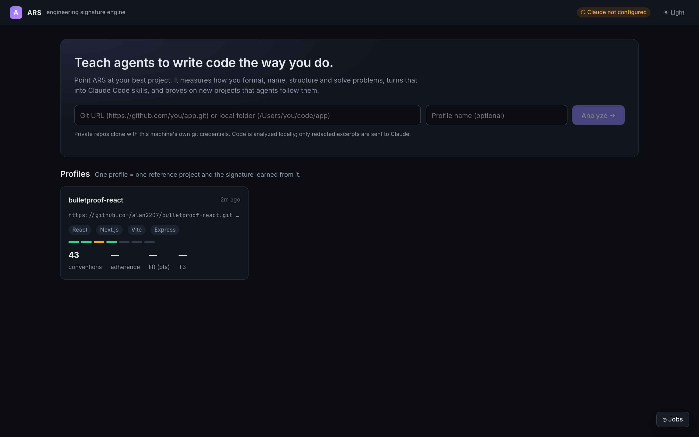

# Getting started

This guide takes you from a fresh clone to a tested skill package for one of your projects.

## 1. Install

You need **Node 22.13 or newer** (ARS uses the built-in `node:sqlite` module), git and npm.

```bash
git clone https://github.com/ars-engine/ars.git && cd ars
npm install
npm run dev
```

`npm run dev` starts two processes:

| Process | Address | What it is |
|---|---|---|
| API | http://127.0.0.1:4317 | the engine behind a small HTTP API |
| UI | http://localhost:5317 | the web app (Vite dev server, proxies `/api` to the API) |

Open http://localhost:5317.

You may see `ECONNREFUSED 127.0.0.1:4317` proxy errors and a SQLite `ExperimentalWarning` during the first second or two. Both are harmless; see the [FAQ](faq.md#startup-shows-econnrefused-1270014317).

## 2. Give ARS access to Claude (optional at first)

Analysis, review, skill packages, the checker and the edit hook run entirely on your machine. Claude is needed for:

| Feature | Needs |
|---|---|
| Ingest, formatting inference, AST mining, self-tests, review, skill packages, install, edit hook, `ars check` | nothing |
| Deep-read (architecture and voice rules, style dossier), held-out file briefs, rubric judge, T3 judge, instruction rewrites | an Anthropic API key |
| Agent runs (Playground, Lab experiments, promotion gates, counterfactuals) | the Claude Agent SDK: an API key, **or** a Claude Code login |

### Using an API key

1. Sign in at [console.anthropic.com](https://console.anthropic.com).
2. Add credit under **Settings → Billing**. A new account has a $0 balance, and every call fails until you add credit.
3. Create a key under **API Keys** and copy it. It starts with `sk-ant-` and is shown once.
4. Export it in the terminal you start ARS from, then restart ARS:

```bash
export ANTHROPIC_API_KEY=sk-ant-...
npm run dev
```

The API prints `Claude API: configured` on startup, and the UI's top bar shows Claude as connected.

> **A Claude Pro or Max subscription is not API credit.** Claude Code can work while ARS's key fails with "credit balance is too low". The two are billed separately. See [Costs](costs.md).

Set a monthly spend limit in the Console before running Lab experiments. See [Costs](costs.md) for what each action spends.

## 3. Analyze your first project

ARS supports **React projects written in TypeScript or JavaScript**. Other stacks, such as Python or Go, aren't supported yet.

On the home page, paste either of these for a React project:

- a Git URL, such as `https://github.com/you/app.git`. Private repositories clone with your machine's own git credentials.
- a local folder, such as `/Users/you/code/app`. ARS reads it and never writes to it.



Pick your **best, most "you" project**. ARS learns whatever it sees, including habits you would rather not teach.

The analysis runs in the background with a live log. Afterwards, the workspace opens with the pipeline rail on the left:

```
1 Ingest → 2 Signature → 3 Review → 4 Skills → 5 Playground → 6 Lab → 7 Improve
```

## 4. Walk the pipeline

The short version follows. [Workflow](workflow.md) explains every screen.

1. **Ingest**: check what was read and skipped, which secrets were redacted, and which files were held out for testing.
2. **Signature**: read what ARS learned, with evidence for every rule.
3. **Review**: approve, reject or reword each rule. **Only approved rules reach the skills and the scores**, so finish this step properly.
4. **Skills**: generate a version and read the `SKILL.md` files.
5. **Playground**: try one prompt with and without the skills.
6. **Lab**: run a real experiment. A good first run is T1 + T2 + T3, all three conditions, 2 repeats.
7. **Improve**: diagnose failing rules, gate the fixes, and promote the ones that pass.

## 5. Start a new project with your skills

This is what ARS is for: create a new project (or open one), install the package, and ask Claude Code to build features. The skills guide it, and the edit hook keeps formatting and enforced rules on track.

From **Skills → Install into a project**, or from the command line:

```bash
npm run ars -- install data/profiles/<profile-id>/skills/<version-dir> /path/to/new-project --slug my-style
```

This writes `.claude/skills/ars-<slug>-*`, `.ars/<slug>/rules.json` and a hook in `.claude/settings.json`. Start Claude Code in that project as usual. See [CLI and hook](cli.md).

## Configuration

| Variable | Default | Meaning |
|---|---|---|
| `ANTHROPIC_API_KEY` | (unset) | Messages API and Agent SDK access |
| `ARS_MODEL` | `claude-opus-5-5` | model for deep-read, judges and rewrites |
| `ARS_AGENT_MODEL` | `claude-opus-5-5` | default model for agent runs (can be changed per experiment) |
| `ARS_DATA` | `./data` | where profiles, runs and the database live |
| `PORT` | `4317` | API port |

All state lives in `ARS_DATA` and is git-ignored. Delete that folder for a clean start.
