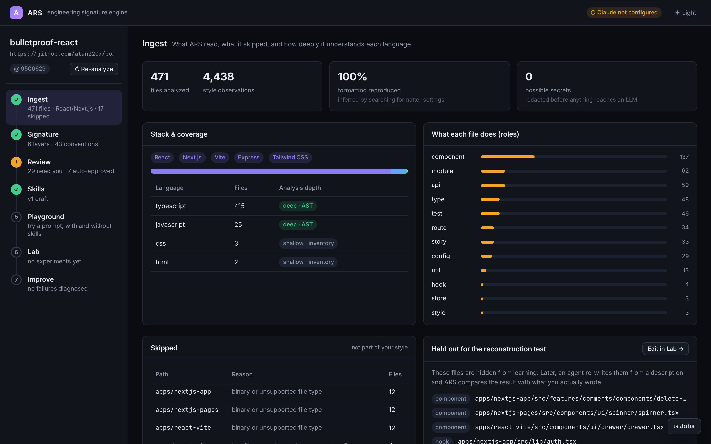
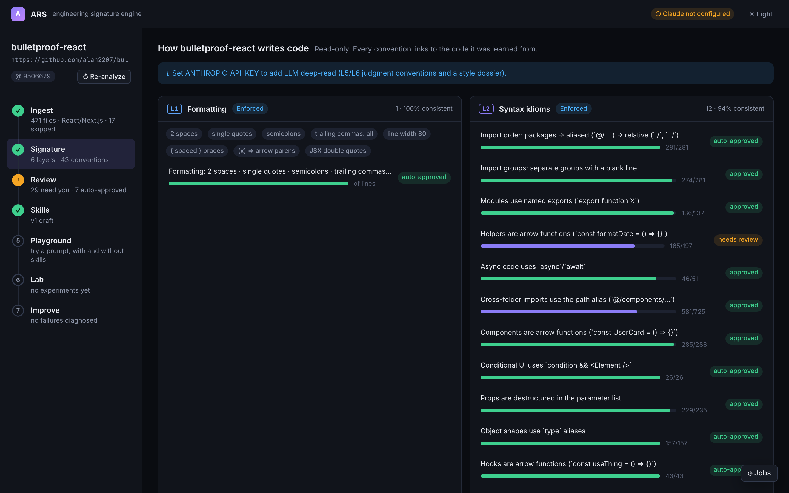
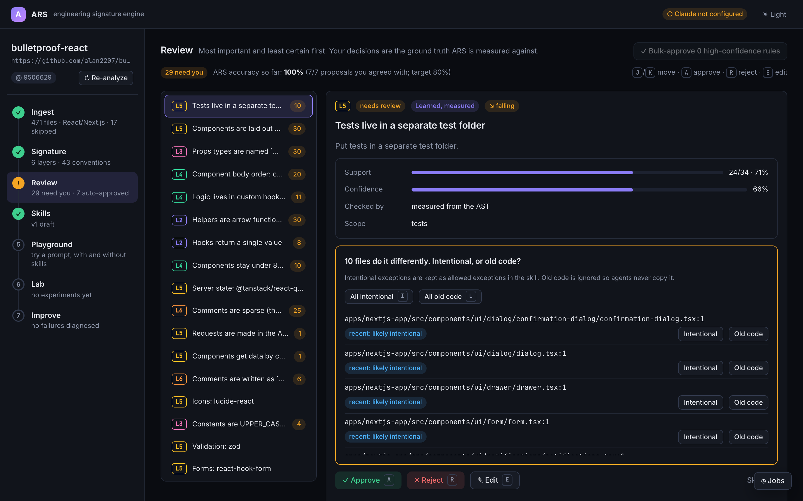
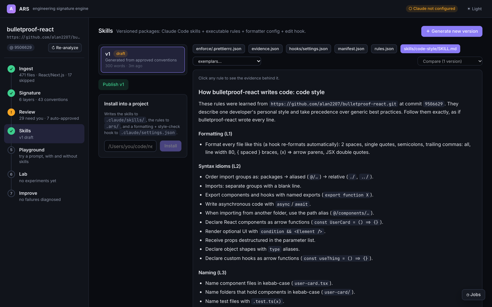
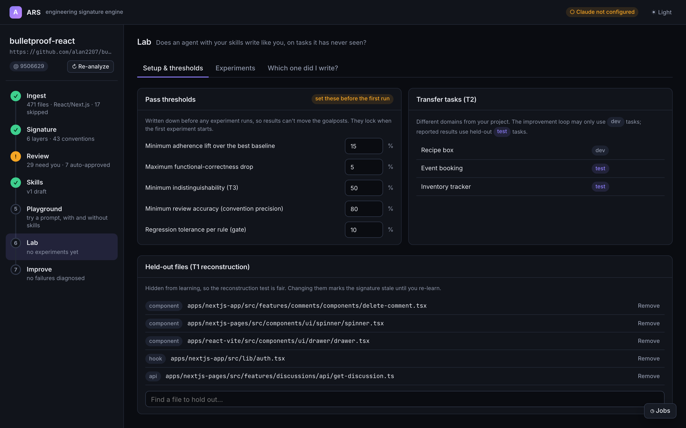

# Workflow

The workspace rail runs top to bottom. Each step shows a state: ✓ done, **!** needs you, **↻** stale (an earlier step changed), or a number when not started.

```
1 Ingest → 2 Signature → 3 Review → 4 Skills → 5 Playground → 6 Lab → 7 Improve
```

## 1. Ingest

*What ARS read, what it skipped, and how deeply it understands each language.*

- **Counts**: files analyzed, style observations, how much of your code the inferred formatting reproduces, and possible secrets.
- **Stack & coverage**: detected languages and frameworks. **Deep** analysis means full AST mining (TS/JS/React); **shallow** means an inventory only.
- **Roles**: what each file is (component, hook, api, store, route, test, type, util…). Most rules are scoped to a role.
- **Skipped**: vendored, generated, binary and oversized (>300 KB) files, grouped by folder and reason.
- **Held out**: the files hidden for the reconstruction test. See [Concepts](concepts.md#held-out-files).
- **Possible secrets**: redacted before anything is sent to Claude or written into a skill.

**↻ Re-analyze** in the sidebar learns again from the project's current state (pulling first for Git URLs). Your decisions carry over.



## 2. Signature

*Read-only. Every convention links to the code it was learned from.*

- Conventions grouped by layer, with support, confidence and trend. Badges show **distinctive** or **generic habit** once a baseline exists.
- **What changed in your style since the previous analysis**, after a re-analyze.
- **Style dossier**: a 200–400 word description of how you write code, from the Claude deep-read (needs an API key).



## 3. Review

*Most important and least certain first. Your decisions are the ground truth ARS is measured against.*

For each pending convention:

- **Approve**, **reject**, or edit the instruction and **Save instruction**.
- Resolve **exceptions**. *Intentional* exceptions become allowed exceptions in the skill. *Old code* (legacy) is ignored, so agents never copy it. Bulk buttons apply one answer to all exceptions.
- For voice and judgment rules, **Does this read like you?** shows a sample in a neutral domain. Your answer approves or rejects the rule and calibrates the judge that scores it.

**Approve deterministic (L1–L3) rules with ≥85% confidence** clears the objective rules in one click. **ARS accuracy so far** tracks how often you agreed with its proposals.

Finish the inbox before generating skills. Pending rules are neither taught nor scored.



## 4. Skills

*Versioned packages: Claude Code skills + executable rules + formatter config + edit hook.*

- **＋ Generate new version** builds a package from the currently approved conventions. If you made review decisions after the latest version, the stage shows **↻ stale**.
- The file bar shows `skills/*/SKILL.md`, `rules.json`, `evidence.json`, `manifest.json`, the hook settings and the formatter config. **Click any rule in a SKILL.md** to open its evidence.
- **exemplars…** lists real files from your project, one per role (component, route, hook, api, store). Each is **de-domained**, meaning business nouns are replaced, and redacted. Held-out files are never used. The `code-style` skill tells the agent to read them before writing similar code.
- **Compare with…** diffs the open file against another version. It's disabled until a second version exists.
- **Publish vN** marks the version you stand behind.
- **Install into a project** writes the package into another repository. See [CLI and hook](cli.md#ars-install).



## 5. Playground

*A quick gut check: the same request with and without your skills.*

Type a prompt, or pick an example, and click **Run both ▶**. ARS runs the agent twice in isolated folders, once with no skills and once with your skills, and shows both results side by side with their scores. The label next to the button names the skill version used: the published one if there is one, otherwise the latest draft.

**⚑ Send failures to Improve** diagnoses the run with skills, just like a Lab experiment.

A Playground run is one sample with no repeats. Use it for intuition, not conclusions.

## 6. Lab

The Lab has three tabs.

### Setup & thresholds

- **Pass thresholds**: these define a passing result. They're written down before any experiment runs, so results can't move the goalposts, and they **lock** when the first experiment starts.

  | Threshold | Default |
  |---|---|
  | Minimum adherence lift over the best baseline | 15 points |
  | Maximum functional-correctness drop | 5 points |
  | Minimum indistinguishability (T3) | 50% |
  | Minimum review accuracy (how often you agree with ARS's proposals) | 80% |
  | Regression tolerance (promotion gate) | 10 points |

- **Transfer tasks (T2)**: the apps the agent builds, in domains unrelated to yours, split into *dev* and *test*. See [Reading results](reading-results.md#the-t2-tasks).
- **Held-out files (T1)**: change which files are hidden.



### Experiments

Choose:

- **Tests**
  - **T1 Reconstruction**: rewrite your held-out files from a description, then compare with your originals. This is the most direct "writes exactly like me" test.
  - **T2 Transfer**: build a new app in a different domain. Acceptance tests check that it works; your rules check that it looks like yours.
  - **T3 Indistinguishability**: a blind judge tries to tell generated files from your real ones. 100% means it can't tell. Needs an API key.
- **Conditions**, all run with the same model, tools and budget:
  - **No skills**: a plain agent.
  - **Generic React guide (length-matched)**: a reasonable, impersonal guide as long as your skills. This separates "having any guide" from "having *your* guide".
  - **Your ARS skills**.
- **Repeats per task**, **T2 tasks** (held-out test, dev or all), **model**, **budget cap per run** and **Judge rubric rules**.

The estimate next to **Run experiment ▶** shows the number of agent runs and a rough cost. See [Costs](costs.md).

**Baseline probe** runs a single no-skills run on the dev task. It's the cheapest way to learn which rules are generic habits. See [Concepts](concepts.md#distinctive-vs-generic-habits).

**Cancel** in the job log stops an experiment within about a second, including any test process it started. An experiment also stops by itself on account errors, such as no credit or a bad key, instead of failing every remaining run.

The **Scorecard** shows each condition's adherence with its 95% CI, its per-layer scores, its functional score and the verdict. **Runs** lists every run: open one to see its files, violations, transcript and which skills it loaded. [Reading results](reading-results.md) explains every number.

### Which one did I write?

The human version of T3. ARS shows you two files: one of your real components, hooks or routes, and one an agent wrote in a Lab run. You guess which is yours. Your hit rate gives an indistinguishability score.

> The generated file can come from any condition's runs, not only the ones with your skills.

## 7. Improve

*Failures are diagnosed from evidence. Fixes are proposed, gated, and promoted only when results improve.*

1. Choose a finished experiment and click **Diagnose failures**. Every approved rule under **90% adherence** in the runs with skills becomes a **proposal** with a diagnosis:

   | Diagnosis | How ARS decides | Proposed fix |
   |---|---|---|
   | **Checker wrong** | the rule's self-test failed | score it with the rubric judge instead |
   | **Learned wrong** | confidence below 60%: weak support in your code | remove the rule |
   | **Not loaded** | no failing run loaded the skill that contains it | sharpen the skill's trigger description |
   | **Unclear** | rerunning the failing task with an explicit reminder fixed it | rewrite the instruction (with Claude, or deterministically) |
   | **Ignored** | the reminder did not help | enforce it in the edit hook |

   The reminder rerun is a **counterfactual**. At most 2 run per diagnosis, so cost stays bounded. If you disagree with a diagnosis, recategorize the proposal and the fix is recomputed.

2. **Gate** a proposal (needs an API key). ARS builds a candidate skill version and runs it against the current version on dev and held-out tasks, with at least 2 repeats. The gate passes only if:
   - the target rule improves by at least 10 points, or reaches 100%,
   - no other rule drops by more than the regression tolerance,
   - functional correctness drops by no more than the threshold,
   - held-out adherence drops by no more than 2 points.

3. **Promote** a proposal that passed. This publishes the candidate. Promotion is always your click; ARS never promotes on its own.
